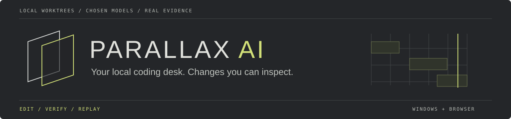
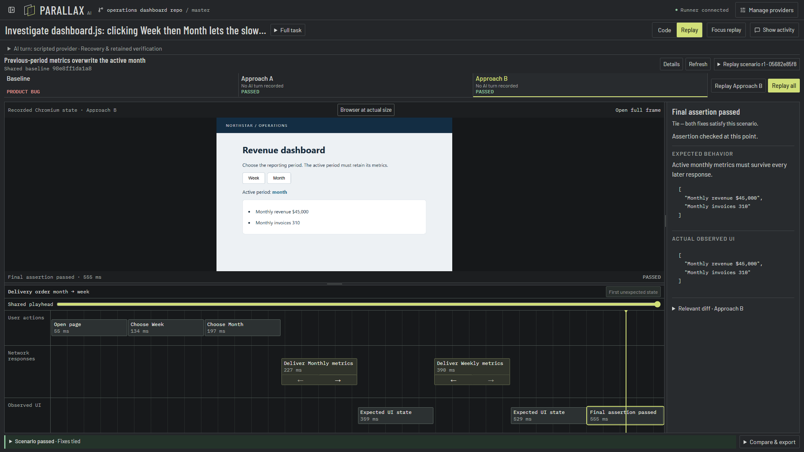
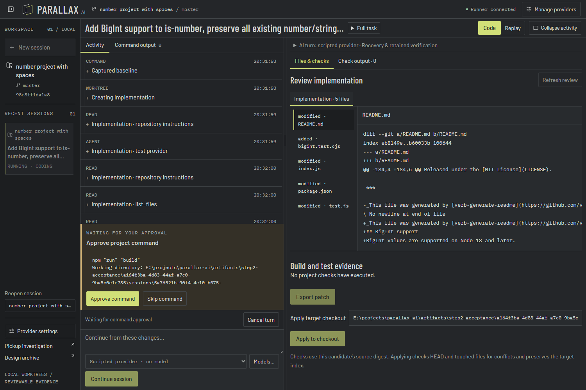
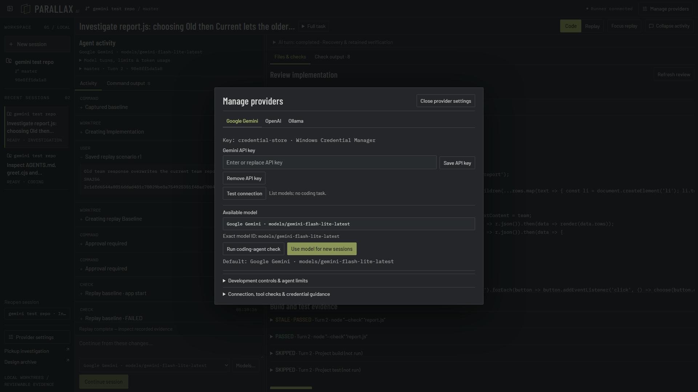
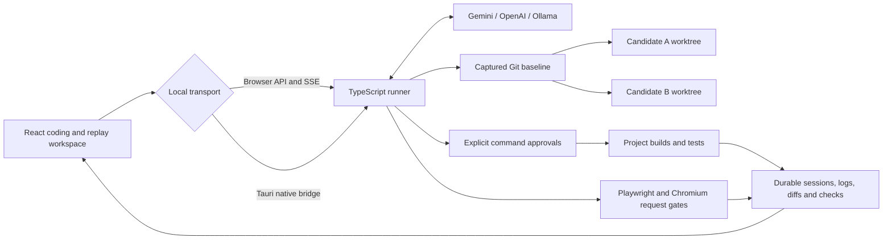

<p align="center">
  
</p>

<p align="center"><strong>A desktop coding agent with changes you can inspect and browser behavior you can replay.</strong></p>

<p align="center">
  <a href="https://github.com/Sahiru2007/parallax-ai/releases/tag/v0.1.0-alpha.3">Download for Windows</a> ·
  <a href="#quick-start">Run from source</a> ·
  <a href="#compare-and-replay">Compare and Replay</a> ·
  <a href="#documentation">Documentation</a> ·
  <a href="https://github.com/Sahiru2007/parallax-ai/issues">Report an issue</a>
</p>

---

PARALLAX AI is a local workspace for making, reviewing, and verifying code changes. Open a Git repository, describe a task, and let your chosen model work in an isolated worktree. Review its actual file changes, approve project commands, and retain the conversation and completed evidence when a turn is interrupted.

For browser timing bugs, go further: capture a baseline, control HTTP response delivery, compare two fixes under the same scenario, and export a standalone Playwright regression test.

**Current release: `0.1.0-alpha.3` · Windows x64 · Experimental alpha.** The Windows app bundles its runner, Node/npm, Git, and replay browser. Gemini, OpenAI, and local Ollama are supported. A completed AI turn and a passing verification are separate outcomes; model capability and provider availability determine what an agent can accomplish.



_Actual dashboard replay from controlled acceptance. The scripted provider is labeled in the UI; Chromium execution, worktrees, captured frames, assertions, and diffs are real. Both fixes satisfy this scenario, so the comparison shows a tie._

## What you can do

| Workflow                | What PARALLAX provides                                                                                                                                   |
| ----------------------- | -------------------------------------------------------------------------------------------------------------------------------------------------------- |
| **Everyday coding**     | Plain-English tasks, repository instructions, file search/read/edit tools, approved build/test commands, follow-ups, and file-by-file review.            |
| **Compare approaches**  | Independent A/B worktrees from one baseline. Conversations, tool receipts, and patches stay separate. Generate both or work sequentially.                |
| **Compare and Replay**  | Saved browser scenarios, explicit request gates, editable response order, DOM observations, captured frames, and aligned checkpoints.                    |
| **Reviewable evidence** | Passed, failed, skipped, stale, and execution-error states; source/scenario revisions; full command logs; patch and regression exports.                  |
| **Recovery**            | Durable model checkpoints, retained edits and completed tools, Resume, bounded retry handling, and explicit additional round allowances.                 |
| **Provider choice**     | Gemini or OpenAI cloud APIs, or loopback Ollama. Exact selected model IDs, plus returned model IDs and usage when supplied.                              |
| **Windows desktop**     | A native Tauri window, folder picker, per-user storage, bundled production assets/runtimes, and a no-key example. Browser development remains available. |

## Download and releases

Get the [Windows x64 alpha.3 prerelease](https://github.com/Sahiru2007/parallax-ai/releases/tag/v0.1.0-alpha.3). Assets include the NSIS installer and a SHA-256 checksum file. Read the [release notes](docs/releases/v0.1.0-alpha.3.md) for contents, executed checks, and limitations, or browse the [changelog](CHANGELOG.md).

1. Download `PARALLAX-AI_0.1.0-alpha.3_windows-x64-setup.exe` from the release assets.
2. Run the per-user installer. Launch **PARALLAX AI** from Start; the installer offers an optional desktop shortcut.
3. Connect a provider for coding tasks, or try the no-key pickup-search example.

The installed app loads its own production assets and starts its bundled runner on an available private loopback port. It does not need Vite, a development runner, or this source checkout. Node/npm, Git, Chromium headless shell, FFmpeg, and Microsoft's offline WebView2 installer are included. Other languages and project-specific dependencies still need their own tooling. Ollama is a separately installed service.

**The installer is unsigned.** Windows may display a publisher/reputation warning. Testing has used the development Windows PC, not a clean Windows environment. Default uninstall retains sessions and credentials; see [desktop storage and uninstall behavior](docs/windows-desktop.md#uninstall-and-limits).

## Quick start

For browser development, use **Node.js 24 LTS**, npm, and Git:

```powershell
git clone https://github.com/Sahiru2007/parallax-ai.git
cd parallax-ai
npm.cmd ci
npx.cmd playwright install chromium
npm.cmd run dev
```

Open **http://127.0.0.1:1420**. The launcher starts Vite and the loopback runner, normally on port `4317`, with a same-origin `/api` proxy. Use `npm` and `npx` without `.cmd` on other shells. The demo needs no API key; arbitrary coding tasks need a configured provider.

For a production browser preview:

```powershell
npm.cmd run build
npm.cmd run preview
```

Open **http://127.0.0.1:1421**. Run one dev/preview launcher at a time; they share the runner port. Rust and Visual Studio are needed only when building the desktop application.

## Your first coding session

1. **Connect a model.** Open **Manage providers**, save a cloud key or connect Ollama, test the connection, select an exact model, and run the harmless coding-agent tool check. Select **Use model for new sessions**.
2. **Open a repository.** Browse to or enter the Git checkout root. It needs an existing commit. Review its branch, baseline revision, and notice about included local edits.
3. **Describe the task.** One implementation is the default. Select **Compare approaches** for independent A/B implementations. The model picker stays beside the composer.
4. **Inspect the work.** The agent reads `AGENTS.md`, searches files, edits its worktree, and displays real activity. Each project command waits for approval showing executable, arguments, and working directory. Approve or skip it.
5. **Continue and verify.** Follow-up instructions build on retained files and conversation. Inspect diffs and command results. If files change after a check, that evidence becomes stale.
6. **Export or apply.** Download the patch or explicitly choose **Apply to checkout**. Apply preflight checks the baseline and touched files; conflicts preserve existing files and staged changes. Changes are never automatically applied, committed, or pushed.



_Controlled acceptance on a separate repository. The exact command and working directory are available before execution._

### Providers and credentials

| Provider          | Setup                                                                                                                         | Execution                                                                                                                                       |
| ----------------- | ----------------------------------------------------------------------------------------------------------------------------- | ----------------------------------------------------------------------------------------------------------------------------------------------- |
| **Google Gemini** | Enter a key, load available models, select an exact ID, and run the tool check. Available Flash-Lite models are sorted first. | Streaming function calling, retained native tool context, visible round counts, API-provided token usage, and bounded request-size diagnostics. |
| **OpenAI**        | Enter a key, load available models, select one, and run the tool check.                                                       | Responses API tools through the same repository tools, approvals, and review workflow.                                                          |
| **Ollama**        | Start a local server, install a tool-capable model, and connect to a loopback HTTP origin.                                    | Installed local models through the same tools. Failures remain visible; there is no automatic cloud fallback.                                   |

A connection test verifies connectivity/model listing. The coding-agent check verifies a harmless tool-call round trip. Neither guarantees a real task will succeed. Changing the default applies to new sessions; existing sessions keep their original provider and model.



Saved cloud keys use **Windows Credential Manager**, accessed by the runner. Saved keys are not returned by the settings API or persisted in renderer storage, session exports, or project-command environments. Development can use runner-side `GEMINI_API_KEY` / `GOOGLE_API_KEY`, or `OPENAI_API_KEY` with `PARALLAX_MODEL`; `.env` is ignored. Never put credentials in task text or `VITE_` variables. OS credential saving fails closed on unsupported platforms; runner environment configuration remains available.

See [Gemini](docs/gemini.md) and [provider settings](docs/providers.md) for replacement/removal, model checks, and environment configuration.

## Compare and Replay

Investigate a local web app where HTTP response order changes the visible result:

1. Open your repo, describe the bug, select **Investigate browser behavior**, and start. An existing coding session can use **Add browser replay**.
2. Configure the **guided scenario editor**: app command/directory/origin/page; click, fill, or select actions; named requests and JSON fixtures; visible-DOM expectations; then review and save. Advanced JSON edits the same configuration. Optional agent proposals need review and do not approve app commands.
3. **Replay Baseline** and approve preparation/start commands. Playwright launches real Chromium, holds selected requests behind explicit gates, delivers fixtures, checks the DOM, and captures frames.
4. Change delivery with drag or keyboard earlier/later controls. **Replay** executes a new run. Scrubbing inspects recorded checkpoints; it does not execute the app again.
5. Generate two fixes, together or sequentially, from the same baseline. **Replay all** uses the same saved actions, fixtures, response order, and assertion against Baseline, A, and B. Switching versions retains the aligned checkpoint.
6. Inspect the first unexpected state, expected/actual UI, request details, relevant diff, and coverage differences. Export the chosen patch and a **standalone Playwright regression**, including fixtures and run instructions. The test has no runtime dependency on PARALLAX.

### What makes the comparison meaningful

- **Same experiment:** changing only delivery order keeps actions, response bodies, and assertion fixed.
- **Real observations:** frames and DOM values come from browser execution; a model does not judge screenshots for pass/fail.
- **Versioned evidence:** results record scenario revision, response order, and source digest. Candidate/scenario edits mark affected evidence stale until replayed.
- **Explicit outcomes:** a failed product assertion differs from an execution error. Missing/ambiguous matches and changed request coverage are surfaced. Equal evidence produces a tie.

Current scope is **local Chromium HTTP fetch/XHR**: 1–20 actions and 1–6 controlled requests with exact URL matching and optional exact body matching. All actions occur before controlled response delivery. WebSockets, remote/HTTPS targets, automatic gesture recording, general authentication setup, wildcard/header matching, and workflows requiring a response before a later action are outside this format.

Read [the replay guide](docs/step-3.md) and [five-step editor guide](docs/step-6.md) for a complete dashboard example and independent regression execution.

### Try the no-key example

Choose **Fix the pickup-search race**, or open `/pickup` in the browser app. Type `Col`, then `Colombo`: an older response arriving last can replace the active results. Reverse the response order and compare both fixes.

The demo uses **prewritten fixes**, labeled as such: a latest-request guard and results keyed by query. Its worktrees, type checks, browser runs, frames, diffs, assertions, and exported tests execute for real. It demonstrates the workflow without pretending to be live model output. The earlier seven-screen prototype remains accessible at `/legacy`.

## Recovery, limits, and evidence

AI-turn status and patch verification are independent. An interrupted turn can retain a useful patch and passed checks. Failed, skipped, stale, interrupted, and unexecuted checks remain distinguishable.

**Resume AI turn** continues the retained conversation in the same worktree. Completed tool receipts prevent repeating acknowledged completed edits or commands. Operations with an uncertain outcome require state inspection; arbitrary project side effects are not transactional.

After a forced native-app crash, the last selected session can revert to an older one. The interrupted session remains available in the rail and **Reopen session** selector; open it explicitly before resuming. This selection limitation was observed during alpha.3 verification.

Temporary HTTP **429/503** responses share a bounded retry mechanism: at most **two automatic retries** and **60 seconds of retry waiting/request time** per explicit continuation. Reported guidance is honored within that budget; long waits, exhausted quota, and persistent failures stop visibly. Waiting is cancellable. Retries retain the model and request context.

The round allowance is visible. Resume preserves it unless you explicitly add a bounded allowance. Token counts appear when supplied by the API. Model context uses bounded file/search/log excerpts; complete redacted command logs remain downloadable. Gemini request diagnostics record byte counts and categories, not source text or credentials.

See [recovery](docs/step-5.md) and [context budgets](docs/model-context.md).

## How the system works



- **Frontend:** React 19, TypeScript, and Vite. The graphite/citron workspace uses locally bundled Barlow, Barlow Condensed, and IBM Plex Mono. Resizable/collapsible panes retain preferences.
- **Runner:** owns provider calls, repository tools, process deadlines/cancellation, worktrees, checkpoints, exports, and replay. Provider credentials are handled here.
- **Repository boundary:** records exact HEAD plus a captured nonignored source snapshot, including eligible local edits. Candidate edits happen in detached worktrees; dependencies are installed there only with approval.
- **Replay engine:** explicit gates, fixed fixtures, observable DOM checkpoints, and captured frames produce versioned evidence.
- **Desktop shell:** Tauri 2/WebView2 loads bundled production assets, starts a private runner on an available port, supplies native folder selection, and owns the process tree. Desktop activity uses state polling; browser development uses SSE.

### Storage and safety boundary

| Mode                 | Default writable data                                                                                                 |
| -------------------- | --------------------------------------------------------------------------------------------------------------------- |
| Windows desktop      | `%LOCALAPPDATA%\dev.parallax-ai.desktop` — sessions/worktrees/evidence, demo checkout, logs, and WebView preferences. |
| Browser development  | `%USERPROFILE%\.parallax\coding-sessions` for everyday sessions; `artifacts/investigations` for the pickup example.   |
| Development override | `PARALLAX_STATE_DIR` sets everyday runner storage. Desktop and development profiles are separate.                     |

The runner validates local origins/hosts and mutation tokens; the native bridge uses a private bootstrap secret. File tools exclude credential files and paths escaping the worktree. Replay traffic is confined to the configured local origin. Patch application is explicit and conservative about conflicts.

**Worktrees are not an OS sandbox.** Approved project code runs with your user's privileges and may have arbitrary side effects. Use trusted projects and review approvals. General automatic merges, automatic application, and automatic cleanup of everyday worktrees are not implemented.

Source capture is limited to approximately **25 MB total / 5 MB per file**, text edits to **200 KB per file**, and review diffs to **150 KB**. Symlinked source is not materialized. Large monorepos may exceed these limits.

## Development and verification

```powershell
npm.cmd run typecheck
npm.cmd run lint
npm.cmd run test:runner
npm.cmd test
npm.cmd run test:coding
npm.cmd run test:production
npm.cmd run format:check
```

These are available commands, not a claim that every suite runs on every commit. Browser suites use real runners, files, worktrees, commands, and Chromium; controlled providers are labeled separately from live API verification. Some acceptance tasks need network access to clone public fixture repositories. Live Gemini verification is opt-in (`npm.cmd run test:gemini:live`) and consumes quota.

To build the Windows installer, install Rust with the MSVC target, Microsoft C++ Build Tools, and a Windows SDK, then run:

```powershell
npx.cmd playwright install chromium --only-shell
npm.cmd run desktop:build
```

The single packaging path is **Tauri 2 + per-user NSIS**. Outputs are under `src-tauri/target/release/bundle/nsis/`; generated runtimes and installers are excluded from Git. See [Windows packaging](docs/windows-desktop.md) for resource staging, lifecycle behavior, and test scope.

### Repository map

```text
src/features/agent/       Coding workspace, approvals, recovery, replay and review
src/LegacyApp.tsx        Earlier seven-screen prototype at /legacy
runner/                  Providers, tools, persistence, processes and replay
shared/                  Typed sessions, provider contracts and scenarios
fixtures/pickup-search/  Runnable no-key race-condition example
scripts/                 Dev launchers, packaging and verification
tests/                  Browser, coding, production and native acceptance
src-tauri/               Windows shell, bridge, icons and NSIS configuration
public/fonts/            Offline fonts and their licenses
docs/                    Setup, workflows, release notes and screenshots
```

## Status and known limitations

PARALLAX is experimental, not a guarantee of an autonomous fix. Live Gemini has completed a small coding/edit/approved-test task; OpenAI/Ollama adapter checks using doubles do not establish live model capability. Small public BugsJS evaluations exposed prolonged investigation, provider interruptions, and failed/partial patches. The retained Express-1 continuation reached its original 18-round ceiling with **no edit and no passing regression**. This project makes no benchmark-performance claim from those small samples.

Provider catalogs, tool support, quota, and pricing are external. No live-provider calls are required for the demo or routine controlled tests. Windows installers are unsigned; clean-machine installation and signed distribution remain outstanding. Only Windows x64 desktop packaging is provided.

## Documentation

| Guide                                                                        | Contents                                                                          |
| ---------------------------------------------------------------------------- | --------------------------------------------------------------------------------- |
| [Windows desktop](docs/windows-desktop.md)                                   | Build, runtimes, storage, startup, process ownership, uninstall, and test limits. |
| [Providers](docs/providers.md) / [Gemini](docs/gemini.md)                    | Keys, exact models, connection/tool checks, Ollama, and live verification.        |
| [Project replay](docs/step-3.md)                                             | Matching, checkpoints, comparison, and standalone regression export.              |
| [Scenario editor](docs/step-6.md)                                            | Guided setup, JSON, drafts, proposals, and dashboard reproduction.                |
| [Interrupted work](docs/step-5.md)                                           | Resume, sequential candidates, usage, and allowances.                             |
| [Context and retries](docs/model-context.md)                                 | Bounded observations, full logs, diagnostics, and 429/503 recovery.               |
| [Design](docs/graphite-design.md) / [Layout](docs/workspace-layout.md)       | Graphite/citron identity, fonts, desktop panes, and accessibility checks.         |
| [Release notes](docs/releases/v0.1.0-alpha.3.md) / [Changelog](CHANGELOG.md) | Downloads, checks, limitations, and release history.                              |

Older step documents retain their original verification scope; release notes distinguish later repairs and checks.

## Feedback and licensing

[Open an issue](https://github.com/Sahiru2007/parallax-ai/issues/new) with the version, OS, provider/model, reproduction steps, and redacted logs. Do not attach API keys, private source, or credentials. Discuss substantial changes before opening a pull request; keep routine verification independent of paid APIs where possible.

No project-wide open-source license has been selected. Public source availability does not grant general reuse rights. Fonts and runtime dependencies retain their own licenses; [font notices](public/fonts/README.md) and bundled runtime notices accompany those assets.
